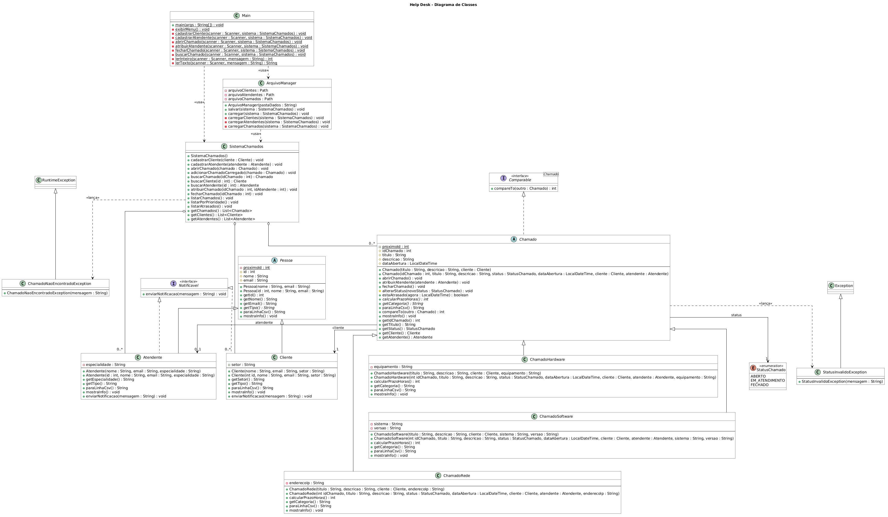

# Help Desk – Sistema de Chamados de TI

Projeto final da disciplina **C06 – Programação Orientada a Objetos** (Inatel), Prof. Christopher Lima.

## Sobre o projeto

Sistema de console, em Java, para o suporte de TI de uma empresa. Os funcionários (clientes) abrem chamados de **Hardware**, **Software** ou **Rede**. Um atendente assume cada chamado e o fecha quando termina. Cada tipo de chamado tem o seu prazo de atendimento: Rede 4 h, Software 24 h e Hardware 48 h. Com isso o sistema lista os chamados em aberto do mais urgente para o menos urgente e mostra os que já passaram do prazo. Os dados ficam salvos em arquivos `.csv` e são carregados de novo quando o programa abre.

O tema é da área de Software/Computação: o help desk (service desk) é um dos processos de gestão de serviços de TI que mais aparecem nas empresas.

## Integrantes

| Integrante | Parte |
|---|---|
| Cassiano Eller Vitoriano Fonseca | Integrante 1 – Modelagem, Usuários, Menu e UML |
| Guilherme Ferreira | Integrante 2 – Módulo de Chamados |
| Adriano Benedito Ferreira Filho | Integrante 3 – Infraestrutura |

## Como executar

Requisito: JDK 11 ou superior.

O programa lê e grava os arquivos da pasta `dados/`, por isso precisa ser executado **a partir da raiz do projeto** (a pasta `help-desk-system`).

**IntelliJ IDEA:** abrir a pasta `help-desk-system`, marcar `src` como *Sources Root* (se ainda não estiver marcada) e rodar a classe `br.inatel.cdg.helpdesk.Main`.

**Terminal (Git Bash, Linux ou macOS):**

```bash
javac -encoding UTF-8 -d out $(find src -name "*.java")
java -cp out br.inatel.cdg.helpdesk.Main
```

**PowerShell (Windows):**

```powershell
javac -encoding UTF-8 -d out (Get-ChildItem src -Recurse -Filter *.java).FullName
java -cp out br.inatel.cdg.helpdesk.Main
```

## Funcionalidades

| Opção | O que faz |
|---|---|
| 1 | Cadastrar cliente (nome, e-mail e setor) |
| 2 | Cadastrar atendente (nome, e-mail e especialidade) |
| 3 | Abrir chamado de Hardware, Software ou Rede |
| 4 | Atribuir um atendente ao chamado (passa para `EM_ATENDIMENTO`) |
| 5 | Fechar chamado (passa para `FECHADO`) |
| 6 | Buscar chamado pelo id |
| 7 | Listar todos os chamados |
| 8 | Listar os chamados em aberto por prioridade (menor prazo primeiro) |
| 9 | Listar os chamados atrasados |
| 0 | Sair |

O status só pode seguir a ordem `ABERTO` → `EM_ATENDIMENTO` → `FECHADO`. Qualquer outra transição é recusada. O cliente e o atendente recebem uma notificação a cada mudança. Os arquivos são gravados depois de cada operação que altera dados (opções 1 a 5).

## Estrutura do projeto

```
help-desk-system/
├── src/br/inatel/cdg/helpdesk/
│   ├── Main.java          menu do console
│   ├── usuario/           Pessoa (abstrata), Cliente, Atendente, Notificavel (interface)
│   ├── chamado/           Chamado (abstrata), ChamadoHardware, ChamadoSoftware, ChamadoRede, StatusChamado (enum)
│   ├── sistema/           SistemaChamados
│   ├── arquivo/           ArquivoManager
│   └── excecao/           ChamadoNaoEncontradoException, StatusInvalidoException
├── dados/                 clientes.csv, atendentes.csv, chamados.csv (dados de exemplo)
└── docs/                  uml.png e UML.md (diagrama de classes)
```

## Conceitos de POO aplicados

| Conceito | Onde está no código |
|---|---|
| Classes e encapsulamento | Atributos `private` e `protected`. Cada classe tem dois construtores: um para o cadastro novo, com o id gerado pelo atributo `static proximoId`, e outro para carregar do arquivo. |
| Herança | `Pessoa` → `Cliente` / `Atendente` e `Chamado` → `ChamadoHardware` / `ChamadoSoftware` / `ChamadoRede`, com `super(...)` nos construtores e `super.mostraInfo()` / `super.paraLinhaCsv()`. |
| Polimorfismo | `calcularPrazoHoras()`, `getCategoria()`, `paraLinhaCsv()` e `mostraInfo()` com `@Override`. O `SistemaChamados` guarda todos os tipos como `Chamado`. O `ArquivoManager` grava qualquer chamado com `paraLinhaCsv()` sem saber o tipo. `enviarNotificacao()` é diferente para cliente (e-mail) e atendente (painel). |
| Classes abstratas | `Pessoa` (método abstrato `getTipo()`) e `Chamado` (métodos abstratos `calcularPrazoHoras()` e `getCategoria()`). |
| Interfaces | `Notificavel`, implementada por `Cliente` e `Atendente`. `Comparable<Chamado>`, usada para ordenar por prioridade com `Collections.sort`. |
| Coleções | `HashMap<Integer, Chamado>` para buscar o chamado pelo id e `ArrayList` para clientes e atendentes. |
| Enum | `StatusChamado` (`ABERTO`, `EM_ATENDIMENTO`, `FECHADO`). |
| Tratamento de erros | `StatusInvalidoException` (checked, com `throws`) e `ChamadoNaoEncontradoException` (unchecked, estende `RuntimeException`). No `Main`, `try/catch` com `InputMismatchException` e `IllegalArgumentException`. No `ArquivoManager`, *multi-catch*, `finally` e `IOException`. |
| Arquivos | `java.nio`: `Files.readAllLines`, `Files.writeString`, `Files.exists` e `Paths.get`, com os campos separados por `;`. |
| Boas práticas | Pacotes por responsabilidade, nomes significativos e Git flow (`feat/*` → `dev` → `main`). |

## Divisão de Tarefas

### Integrante 1: Modelagem, Usuários e Menu – Cassiano Eller Vitoriano Fonseca

**Responsável por:** `Pessoa`, `Cliente`, `Atendente`, a interface `Notificavel`, o menu (`Main`) e o diagrama UML.

**O que implementar:**
- `Pessoa` como classe abstrata, com os atributos id, nome e email.
- `Cliente` e `Atendente`, que estendem `Pessoa` e implementam `Notificavel`.
- `Notificavel` com o método `enviarNotificacao(String mensagem)`.
- O menu do console, que lê os dados do usuário e trata as entradas inválidas.

**Requisitos:** classes, herança, classe abstrata, interface, boas práticas e UML.

**Precisa saber explicar:** a herança `Pessoa` > `Cliente` / `Atendente`, a classe abstrata `Pessoa`, a interface `Notificavel`, o menu e o diagrama UML.

---

### Integrante 2: Módulo de Chamados – Guilherme Ferreira

**Responsável por:** `Chamado`, `ChamadoHardware`, `ChamadoSoftware`, `ChamadoRede`, `StatusChamado` e `StatusInvalidoException`.

**O que implementar:**
- `Chamado` como classe abstrata, com idChamado, titulo, descricao, status, data de abertura, cliente e atendente, e os métodos `abrirChamado()`, `atribuirAtendente()`, `fecharChamado()` e `alterarStatus()`.
- O enum `StatusChamado`, com os valores ABERTO, EM_ATENDIMENTO e FECHADO.
- Os três tipos de chamado (Hardware, Software e Rede), que estendem `Chamado` e definem o seu prazo em `calcularPrazoHoras()`.
- A exceção `StatusInvalidoException` para as transições de status inválidas.

**Requisitos:** classes, classe abstrata, herança, polimorfismo, tratamento de erros e parte do UML.

**Precisa saber explicar:** classe abstrata, polimorfismo, os tipos de chamado, os status e a exceção checked.

---

### Integrante 3: Infraestrutura – Adriano Benedito Ferreira Filho

**Responsável por:** `SistemaChamados`, `ArquivoManager`, `ChamadoNaoEncontradoException`, os dados de exemplo (`dados/`) e a integração no GitHub.

**O que implementar:**
- O gerenciamento das listas e dos métodos principais (`SistemaChamados`), incluindo a ordenação por prioridade e a lista de atrasados.
- A persistência em `.csv` (`ArquivoManager`).
- A exceção personalizada (`ChamadoNaoEncontradoException`).
- O merge das branches e a integração do sistema.

**Requisitos:** coleções, tratamento de erros, arquivos, classes, GitHub e parte do UML.

**Precisa saber explicar:** coleções (`HashMap` e `ArrayList`), a ordenação com `Comparable`, exceções (checked e unchecked), arquivos, o uso do GitHub e a integração do sistema.

---

## Diagrama UML



A explicação do diagrama está em [docs/UML.md](docs/UML.md).

## Uso de IA

Como pede o enunciado, o grupo declara aqui se usou IA, como usou e qual ferramenta. O detalhe de cada integrante está em [IA_README.md](IA_README.md).

| Integrante | Usou IA? | Ferramenta | Como usou |
|---|---|---|---|
| Adriano Benedito Ferreira Filho | Sim | Claude (Anthropic), pelo Claude Code | Organização das tarefas e do esqueleto das classes, implementação do `SistemaChamados` e do `ArquivoManager`, integração das branches e revisão deste README. Todo o código foi revisado com os slides das aulas e testado rodando o sistema. |

Os commits feitos com ajuda da IA têm a linha `Co-Authored-By: Claude` no histórico do Git.
